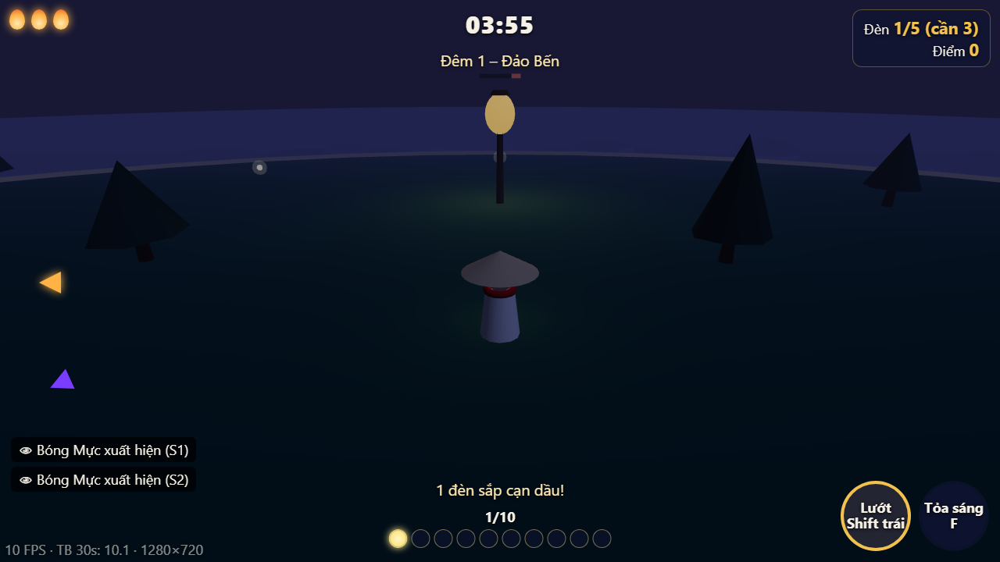

# Đảo Đèn Lồng

> **Video demo:** [docs/demo/demo.mp4](docs/demo/demo.mp4) (cũng đính kèm ở [Release v1.0.0](../../releases/tag/v1.0.0)) · **Bằng chứng:** [Phase 1](docs/proof/phase-1/README.md) · [Phase 2](docs/proof/phase-2/README.md) · [Phase 3](docs/proof/phase-3/README.md) · [Phase 4](docs/proof/phase-4/README.md) · [CHANGELOG](CHANGELOG.md) · [Retro](docs/notes/retro.md) · [ADR](docs/adr/0001-lantern-fuel-and-dawn-win.md) · Đề bài gốc: [docs/lab/](docs/lab/README.md)

Game 3D góc nhìn thứ ba. **Mây**, người giữ đèn nhỏ tuổi đội nón lá, gom đom đóm để thắp và **giữ cho các Đèn Lồng Lớn sáng tới bình minh** qua **3 Đêm**: Đảo Bến, Đảo Cau (hai đảo nối bằng cầu tre) và Đảo Chuông (ba tầng, gió mạnh). Đèn cạn dầu dần và Bóng Mực tìm tới hút dầu, nên Mây phải châm dầu, thắp lại đèn, xua Bóng Mực bằng Tỏa Sáng và giữ đom đóm khỏi Gió Lạc.

Cá nhân · MSSV 2A202603462 · Nguyễn Quang Duy · Lab Day 12 AI SDLC · Test Contract **v1.3**.



## Yêu cầu hệ thống
- **Node.js ≥ 18** trên macOS, Linux hoặc Windows. Game không có dependency lúc chạy; three.js 0.170.0 đã đóng gói sẵn trong `vendor/`.
- Trình duyệt có WebGL2 (Chrome, Edge, Firefox, Safari bản mới).
- Chỉ **bench** và kiểm tra UI tự động mới cần Playwright và Chromium (khoảng 150 MB), được cài bằng lệnh build bên dưới.

## Cài đặt và chạy (3 lệnh)

```bash
git clone <repo> && cd <repo>
npm install && npx playwright install chromium   # build_cmd (Playwright chỉ dùng cho bench/UI check)
npm start                                        # mở http://localhost:5173
```

Chỉ muốn chơi thì không cần lệnh thứ hai: `npm start` (tức `node scripts/serve.js`) chạy được ngay sau khi clone. Bản phát hành [v1.0.0](../../releases/tag/v1.0.0) là file zip thư mục web tĩnh: giải nén rồi chạy `node scripts/serve.js`.

## Điều khiển (đổi được trong Cài đặt)

| Phím mặc định | Hành động |
|---|---|
| `W A S D` (và `↑ ↓`) | Di chuyển theo hướng camera |
| Kéo chuột / `← →` | Xoay camera |
| `Space` | Nhảy |
| `Shift` | Lướt |
| `E` | Tương tác: nạp, thắp lại, châm dầu |
| `F` | Tỏa Sáng (tốn 3 đom đóm) |
| `Esc` (hoặc `P`) | Tạm dừng: Tiếp tục / Chơi lại Đêm / Cài đặt / Về menu |

## Luật chơi và điểm (Ticket-03)
- Thắp đèn lần đầu cần 10 đom đóm, thắp lại cần 5. Đèn sáng có **dầu 100**, hao 1/s; bấm `E` để châm (+10 dầu mỗi đom đóm).
- Đèn dưới 30 dầu nhấp nháy, mất vùng an toàn 6 m, và Bóng Mực tới **hút dầu** (5/s).
- **Thắng** khi bình minh tới (240 / 270 / 300 s) mà ≥ 60% đèn đang sáng (3/5, 4/6, 5/7). **Thua** khi hết 3 Ngọn Lửa, hoặc thiếu đèn lúc bình minh.
- Sức chứa = 10 + 2 × số lần thắp thành công (tối đa 20).

| Sự kiện | Điểm |
|---|---|
| Mỗi đom đóm nạp vào đèn (thắp, thắp lại, châm dầu) | +5 |
| Thắp lần đầu / thắp lại | +100 / +40 |
| Bóng Mực trúng Tỏa Sáng (đang hút dầu) | +5 (+15) |
| Bình minh (khi thắng): mỗi đèn sáng / mỗi Ngọn Lửa | +50 + floor(dầu) / +50 |

Mọi con số lấy từ [game.contract.json](game.contract.json). Giả định ở [docs/notes/assumptions.md](docs/notes/assumptions.md).

## Bảng xếp hạng
Thua ở bất kỳ Đêm nào, hoặc thắng Đêm 3 (màn Bình Minh), thì game cho nhập tên: 3–12 ký tự chữ, số, `_`, có hỗ trợ tiếng Việt có dấu. Top 10 được lưu trên đĩa ở `data/leaderboard.json` (server), nên còn nguyên sau khi tắt game. Xem bảng ở Menu → Bảng xếp hạng. Xuất ra file:

```bash
node scripts/serve.js --export-leaderboard out.json   # {"entries":[…]} đúng thứ tự
```

## Dễ tiếp cận
Đổi mọi phím (có báo trùng phím và nút Khôi phục mặc định) · phụ đề và chỉ báo hình ảnh: Bóng Mực xuất hiện (kèm mũi tên ở mép màn hình), gió sắp thổi, 10 s cuối, đèn dưới 30 dầu · **Giảm chuyển động** (tắt rung camera và chớp) · chữ tối thiểu 18 px, tùy chọn **chữ lớn ×1.25** · **Bảng màu dễ phân biệt** cho người mù màu. Tất cả được lưu lại.

## Test, headless, bench, soak

```bash
npm test                     # 53 test: contract v1.0–1.3, mỗi tính năng có scenario headless; leaderboard; bench scene; soak
node src/headless.js --seed 1 --night 1|2|3 --ticks 600 --out out.jsonl [--scenario s.json] [--inputs i.json] [--snapshot-every 10]
node scripts/bench.js --seed 42 --duration 30 --out bench.json          # bench_cmd
node --expose-gc scripts/soak.js --seed 7 --nights 10 --out soak.json   # soak_cmd
npm run ui-check             # Playwright: menu → 3 Đêm → tạm dừng → cài đặt → thua → nhập tên → bảng xếp hạng
npm run proof -- phase-4     # sinh lại bằng chứng (bot chơi 3 Đêm, tất định, mã lỗi, tốc độ)
```

**Bench:** Playwright mở Chromium cửa sổ 1280×720 (không toàn màn hình) với `--disable-gpu-vsync --disable-frame-rate-limit` (**vsync đã tắt**), tải cảnh chuẩn `index.html?bench=1`: Đêm 1, 200 Bóng Mực `wander`, 100 đom đóm, L1–L3 sáng với 100 dầu, camera bay vòng bán kính 30 m ở Y = 15. Đo 30 s sau 3 s khởi động. `peak_mem_mb` để `null` vì bản web không đọc được RSS của tiến trình trình duyệt; số thay thế là JS heap đọc qua CDP (`peak_js_heap_mb`). Không có màn hình (Linux CI) thì thêm `--headless`, nhưng khi đó FPS dùng GPU phần mềm và không đại diện.

| Số đo (máy dev: i7-8665U, Intel UHD 620, Windows 11) | Kết quả | Ngưỡng |
|---|---|---|
| `avg_fps` | **154.1** | ≥ 60 |
| `p1_low_fps` | **64.3** | ≥ 30 |
| `load_ms` | **1165** | ≤ 10 000 |
| Soak: `crashes`, `mem_end/mem_start` | **0**, 51.7/45.9 = **1.13** | 0, ≤ 1.2 |

File gốc: [bench.json](bench.json), [soak.json](soak.json).

## Cấu trúc

```text
game.contract.json   lệnh + tuning (contract 1.3)
src/core/            logic thuần, không phụ thuộc DOM: game.js (12 bước/tick), maps.js, bench.js, leaderboard.js, validate.js, rng.js
src/headless.js      CLI theo Test Contract
src/main.js          luồng UI 3 Đêm, HUD, input, cài đặt, bảng xếp hạng, chế độ bench
src/render/          world.js (địa hình, bảng màu), audio.js (âm thanh WebAudio)
scripts/             serve.js (server + leaderboard), bench.js, soak.js, ui-check.js, proof.js
tests/               53 test
docs/                notes/ (giả định, spec, nhật ký AI, retro) · adr/ · proof/phase-N/ · lab/ (đề bài gốc)
CLAUDE.md, .claude/skills/proof   harness AI
```

## Sáng tạo của tôi
Tất cả chỉ nằm ở lớp hiển thị và không làm đổi output headless. Bằng chứng là 53 test và hash tất định trong proof.
- Đèn lồng nhỏ trên nón lá của Mây sáng hơn khi Mây mang nhiều đom đóm.
- Đèn trời bay lên mỗi khi một Đèn Lồng Lớn được thắp.
- Lời Ông Đăng giới thiệu từng Đêm; lá bay báo trước gió; Gió Lạc là dải lụa uốn lượn; Bùa Gió đỏ viền vàng xoay tròn.
- Âm thanh tổng hợp bằng WebAudio (nhạc ngũ cung ban đêm), không dùng file ngoài.
- Đèn tắt bị xẹp và có vết rách giấy; Bóng Mực đang hút dầu thì phập phồng.

## Giấy phép
Mã nguồn dùng [MIT](LICENSE). Nguồn tài nguyên và công cụ ghi trong [CREDITS.md](CREDITS.md).
